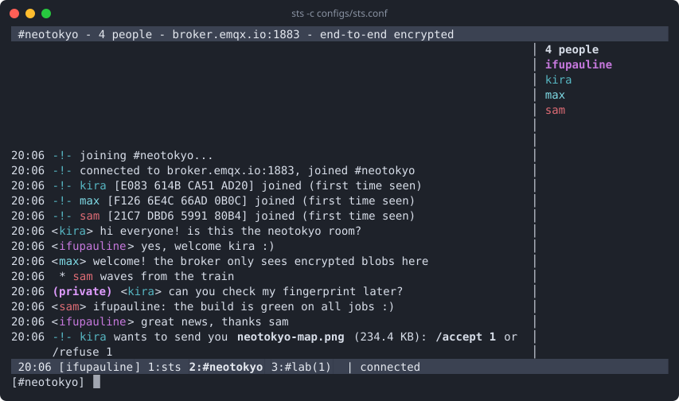

# STS, the Secure Talk System

End-to-end encrypted group chat in the terminal, IRC style, over MQTT.
For Linux.



## What it does

- **End-to-end encryption.** Messages, private messages, files, nicks and
  room names are encrypted and signed on your computer. Only the people in
  the room can read them; the MQTT broker in the middle, even a public one,
  only passes on data it can't read.
- **No account, no server to trust.** Any MQTT broker works, a public one
  or your own. Nothing is stored anywhere: no history on a server, no
  phone number, no sign-up.
- **You know who you talk to.** Each person has a fingerprint. Compare it
  once, `/trust` them, and sts warns you if someone else ever uses their
  nick.
- **Keys that don't last.** They are renewed every 10 minutes and whenever
  someone joins or leaves: a newcomer can't read what was said before,
  who left can't read what comes next, and stolen keys soon stop working.
- **Private messages and files.** `/msg` for one person, `/send` for a
  file, encrypted the same way, checked on arrival, with a progress bar
  and a size limit you choose.
- **IRC in the terminal.** Several rooms in windows, the people of the room
  on the right, tab completion, a "new messages" line.
- **Easy to start.** `sts --init` asks a few questions and writes your
  configuration. Or a single command line.
- **Works almost anywhere.** One outgoing connection to the broker (port
  1883, or 8883 with TLS). A line by line mode for scripts.
- **Small and checked.** One C program with everything it needs in the
  repository, tested against a real broker, with sanitizers and fuzzing.

## Install

You need a C compiler, CMake 3.16 or newer and make.

```sh
sudo apt install build-essential cmake        # Debian, Ubuntu
git clone https://github.com/ifupauline/sts.git
cd sts
make                                          # builds build/bin/sts
sudo make install                             # sts and man sts in /usr/local
```

`make install` also puts the example configurations and this
documentation in `/usr/local/share/doc/sts`. Without it, run
`./build/bin/sts` instead of `sts`.

## Start

```sh
sts --init                    # a few questions, writes ~/.sts/sts.conf
sts -c ~/.sts/sts.conf
```

Type a message and press Enter. `/help` lists the commands, `/quit` or
Ctrl-C leaves. To talk together, people need the same broker, the same
topic prefix and the same room name (and password).

## Examples without TLS

With the ready-made configuration (public broker `broker.emqx.io`, room
`youroom`, nick `yournickname`; copy it and change what you like):

```sh
sts -c configs/sts.conf
```

The same on the command line, no file needed (only `-b` and `-p` are
required):

```sh
sts -b broker.emqx.io -p 1883 -t wonderland -n kira -r youroom
```

A room with a password:

```sh
sts -b broker.emqx.io -p 1883 -t wonderland -n kira -r lab:correct-horse-battery-staple
```

Alone, to try it, two terminals:

```sh
sts -c configs/alice.conf     # terminal 1
sts -c configs/bob.conf       # terminal 2, then /msg alice hello
```

## Examples with TLS

Your messages are end-to-end encrypted with or without TLS. TLS also hides
from the network which room you use, and when. The broker must offer it.

A broker with a public certificate (Let's Encrypt):

```sh
sts -b test.mosquitto.org -p 8886 --tls -t wonderland -n kira -r youroom
```

A broker with its own certificate authority (yours, a friend's,
`broker.emqx.io` on 8883): ask for its CA file, then

```sh
sts -b broker.example.org -p 8883 --tls --ca-file ~/broker-ca.crt -n kira -r youroom
```

In a configuration file:

```ini
broker = broker.example.org
port = 8883
tls = yes
tls_ca_file = ~/broker-ca.crt
```

Certificates explained, your own mosquitto with TLS step by step, and what
the error messages mean: [doc/TLS.md](doc/TLS.md).

## Using it safely

sts protects what you write on the way and on the broker. These habits
protect the rest:

1. **Check fingerprints.** Anyone can take any nick. Before you say
   anything private, compare `/whois NICK` on your screen with the
   person's `/fingerprint` on theirs, in person or on the phone, not in
   the chat. Then `/trust NICK`: a `+` appears in front of the name, and
   sts warns you loudly if that nick comes back with another key.
2. **Look at the people list before you write.** Everyone listed on the
   right reads the room, and only they do. For one person, use `/msg`.
3. **Use a room password**, long and random, and give it in person or
   through another private channel. Without one, anyone who guesses the
   room name can join (they then show up in the list).
4. **Protect your identity key.** `sts --passphrase ~/.sts/identity.key`
   protects it with a passphrase. Never share it or copy it to another
   device: each device gets its own key, and people `/trust` each one.
5. **Leave the chat log off** (the default). If you turn it on, it is
   plain text on your disk.
6. **Use TLS when the broker offers it**, and check the CA file you were
   given (`openssl x509 -in ca.crt -noout -fingerprint -sha256`, compared
   with whoever sent it).
7. **Keep your computer safe.** sts can't protect against malware, a
   shared account or someone reading your screen.
8. **For sensitive groups, run your own broker.** It still can't read
   anything, but you then decide who sees the metadata.

## Security limits

- **The broker sees metadata**: your IP address, which topic (a hash of the
  room name and password), when and how much. TLS hides that from the
  network, not from the broker. sts doesn't make you anonymous.
- **Who is in a room** can be seen, without joining, by someone who knows
  its name and password; what is said can't.
- **Your first 10 seconds in a room**: while sts finds out who is already
  there, it doesn't renew your key when someone joins, so what you write
  then could be read by someone who joins in those same seconds and
  recorded it.
- **Weak room passwords can be guessed offline** by whoever sees the
  topic. That reveals who is in the room, and lets them join (visibly),
  not read the past.
- **The broker can drop messages.** sts notices gaps and asks again, but
  can't force delivery. Messages sent while you are away for long are
  gone: there is no history.
- **Your computer is out of reach**: malware, backups of your home folder,
  an identity key without passphrase, a chat log.
- sts hasn't been audited by an independent security review yet.

What exactly is protected from whom: [doc/SECURITY-MODEL.md](doc/SECURITY-MODEL.md).
To report a vulnerability: [SECURITY.md](SECURITY.md).

## Documentation

| Page                                          | What                                                  |
| --------------------------------------------- | ----------------------------------------------------- |
| [doc/USAGE.md](doc/USAGE.md)                  | the screen, commands, keys, rooms, files, chat log, two instances, troubleshooting, scripts |
| [doc/TLS.md](doc/TLS.md)                      | certificates, TLS examples, your own broker, errors   |
| [doc/SETTINGS.md](doc/SETTINGS.md)            | every setting and option                              |
| [doc/SECURITY-MODEL.md](doc/SECURITY-MODEL.md) | what is protected, from whom                         |
| [doc/PROTOCOL.md](doc/PROTOCOL.md)            | the protocol, byte by byte                            |
| [doc/DEVELOPERS.md](doc/DEVELOPERS.md)        | building, tests, fuzzing, code layout, releases       |
| `man sts`                                     | all of it in short, once installed                    |

## License

Apache License 2.0, see [LICENSE](LICENSE) and [NOTICE](NOTICE). The code
in `vendor/` keeps its own license: Mbed TLS under Apache-2.0, Paho
MQTTPacket under the Eclipse Distribution License 1.0 (BSD-3-Clause) or the
Eclipse Public License 2.0.
