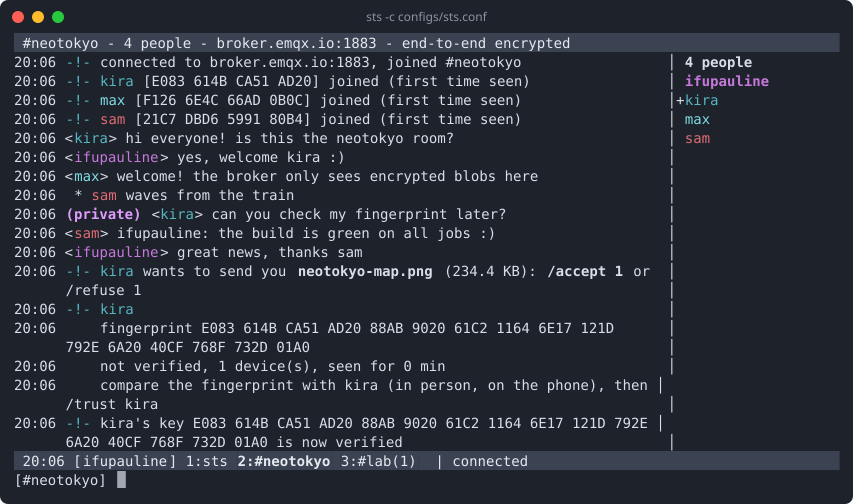

# Using sts

- [The screen](#the-screen)
- [Commands and keys](#commands-and-keys)
- [Rooms and passwords](#rooms-and-passwords)
- [Checking who you talk to](#checking-who-you-talk-to)
- [Sending files](#sending-files)
- [Chat log](#chat-log)
- [Protecting your identity key](#protecting-your-identity-key)
- [Two instances on one computer](#two-instances-on-one-computer)
- [Can't see each other?](#cant-see-each-other)
- [Scripts and pipes](#scripts-and-pipes)

## The screen

```
 #neotokyo - 4 people - broker.emqx.io:1883 - end-to-end encrypted     <- title
20:06 <kira> hi everyone! is this the neotokyo room?        │ 4 people
20:06 <ifupauline> yes, welcome kira :)                     │ ifupauline   <- who is
20:06  * sam waves from the train                           │+kira            in the
20:06 (private) <kira> can you check my fingerprint later?  │ max             room
20:06 <sam> ifupauline: the build is green on all jobs :)   │ sam
 20:06 [ifupauline] 1:sts 2:#neotokyo 3:#lab(1)  | connected           <- status
[#neotokyo] hello_                                                     <- you type here
```

- **On the right**, the people in the room, always up to date. `+` means
  you verified that person, a dimmed name lost its connection (it may come
  back), `(2)` means two devices of the same person. Everyone in a room
  gets their own color (there are 11), usually the same on every screen.
- **The status bar** lists the windows: window 1 is the status window
  (help, errors), then one window per room. `3:#lab(1)` means one unread
  message in window 3, in yellow if someone mentioned you.
- `* sam ...` is an action (`/me`), `(private)` a message only you got.
- Coming back to a window, a `──── new messages ────` line shows where
  you stopped reading.
- During a file transfer, a progress bar is at the end of the status bar.

## Commands and keys

| Command                 | What it does                                     |
| ----------------------- | ------------------------------------------------ |
| `/join ROOM [PASSWORD]` | join a room (or create it), in a new window      |
| `/part [ROOM]`          | leave the room                                   |
| `/msg NICK TEXT`        | private message to someone in the room           |
| `/me TEXT`              | action: `* you TEXT`                             |
| `/nick NICK`            | change your nick                                 |
| `/send NICK FILE`       | send a file                                      |
| `/accept [N] [DIR]`     | accept file N (`/refuse [N]` refuses it)         |
| `/files`                | transfers in progress (`/cancel N` stops one)    |
| `/who`                  | the people in the room, with fingerprints        |
| `/whois NICK`           | someone's full fingerprint                       |
| `/trust NICK`           | mark someone as verified (`/untrust NICK`)       |
| `/fingerprint`          | your own fingerprint                             |
| `/status`               | connection, MQTT topics, encryption              |
| `/win N`                | go to window N                                   |
| `/clear`                | clear the window                                 |
| `/rekey`                | renew your keys now                              |
| `/help`                 | the list of commands                             |
| `/quit`                 | leave every room and exit                        |

| Key                      | Action                                       |
| ------------------------ | -------------------------------------------- |
| Alt-1 ... Alt-9          | go to window 1 to 9                          |
| Ctrl-N / Ctrl-P          | next / previous window                       |
| PgUp / PgDn              | scroll back / forward                        |
| Tab                      | complete a nick or a command                 |
| Up / Down                | input history                                |
| Ctrl-A / Ctrl-E          | start / end of the line                      |
| Ctrl-U / Ctrl-K / Ctrl-W | delete to the start / to the end / a word    |
| Ctrl-C                   | quit                                         |

## Rooms and passwords

A room is just a name, and upper or lower case doesn't matter (`NeoTokyo`
is `neotokyo`). With a password, only the people who know it can see or
join the room. Choose a long one: anyone who guesses the name and the
password can join (and then appears in the list).

```sh
sts -b broker.emqx.io -p 1883 -t wonderland -r lab:correct-horse-battery-staple
```

In the configuration file, one line per room to join on start:

```ini
room = neotokyo
room = lab correct-horse-battery-staple
```

Once started: `/join lab correct-horse-battery-staple`.

The room name never reaches the broker. A room is the MQTT topic
`<topic_prefix>/<hash>`, the hash coming from the room name and password,
for example `wonderland/4be2a0c17f9d3e5b8a61c0d2f7e9b345` (not
`wonderland/neotokyo`). `/status` shows it.

## Checking who you talk to

Nicks can be taken by anyone; fingerprints can't. Each person has an
identity key, created on first start, and its fingerprint is shown when
they join: `kira [8DC9 A17D 35C7 54B0] joined`.

To be sure that "kira" is really Kira, compare fingerprints outside of the
chat (in person, on the phone): `/whois kira` shows hers on your screen,
`/fingerprint` shows yours. If they match, type `/trust kira`: a `+`
appears in front of her name, and sts warns you loudly if the nick `kira`
ever comes back with another key.



## Sending files

```
/send kira ~/photos/neotokyo.jpg
```

Kira sees the offer and decides:

```
-!- ifupauline wants to send you neotokyo.jpg (2.3 MB): /accept 1 or /refuse 1
```

- `/accept 1` saves it in `~/Downloads` (or your home folder if there is
  none), `/accept 1 ~/somewhere` in another folder. With a single offer
  waiting, `/accept` or `/refuse` alone is enough.
- While it moves, both sides see a bar at the end of the status bar:
  `[1] <- movie.mp4 [####------] 42% 340 KB/s 9s left /cancel 1`.
  `/cancel N` stops a transfer from either side, `/files` lists them.
- The file is end-to-end encrypted like a private message, and checked
  (SHA-256) when it arrives. An existing file is never replaced
  (`neotokyo (2).jpg`). To one person at a time.
- The size limit is yours to choose: `max_file_size` (16 MB by default, up
  to 64 GB), on both sides. Kira's sts refuses an offer above her limit by
  itself, and you are told why. Files are read and written as they go, so
  a big file costs no memory, only time: public brokers are often slow
  (EMQX passes about 4 KB/s), your own broker is much faster.

## Chat log

sts keeps nothing on disk by default. With `log = yes` (or `--log`), it
writes what each room window shows to `log_dir/ROOM.log`
(`~/.sts/logs/neotokyo.log`), private messages included, marked
`(private)`:

```
2026-11-10 20:06:12 ---- #neotokyo, as kira ----
2026-11-10 20:06:12 -!- chat log: /home/kira/.sts/logs/neotokyo.log
2026-11-10 20:06:12 -!- joining #neotokyo...
2026-11-10 20:06:15 <ifupauline> yes, welcome kira :)
2026-11-10 20:06:31 (private) <ifupauline> sure, after lunch
```

The files are created readable by you only, but they are **not
encrypted**: anyone who reads your files, or a backup of them, reads your
conversations. Keep it off unless you need it.

## Protecting your identity key

Your identity key (`~/.sts/identity.key`) proves who you are: whoever
copies it can pass for you. It is created readable by you only. To also
protect it with a passphrase:

```sh
sts --passphrase ~/.sts/identity.key
```

sts then asks for the passphrase at each start. The same command changes
it, or removes it (empty passphrase). `sts --init` offers it when it
creates the key. Forgotten passphrase: the key is lost, create a new one
and tell your contacts, whose sts will warn them that your fingerprint
changed.

## Two instances on one computer

To try sts alone, open two terminals. [configs/alice.conf](../configs/alice.conf)
and [configs/bob.conf](../configs/bob.conf) are ready for that: same broker,
same room, two people with their own identity files.

```sh
sts -c configs/alice.conf          # terminal 1
sts -c configs/bob.conf            # terminal 2
```

Then try `/msg bob hello` or `/send bob /etc/hostname` in Alice's window.

On the command line, give each terminal its own identity file, or they all
use `~/.sts/identity.key` and are the same person to the others (shown
with `(2)`, same fingerprint):

```sh
sts -b broker.emqx.io -p 1883 -n alice -r youroom -i ~/.sts/alice.key
sts -b broker.emqx.io -p 1883 -n bob -r youroom -i ~/.sts/bob.key
```

Both files list every setting, the unused ones commented out with `#`. To
test TLS on your own mosquitto (set up as in
[Example 3](TLS.md#example-3-tls-on-your-own-mosquitto)), switch the broker lines
in **both** files: put a `#` in front of the three lines of the public
broker and remove it from the four lines below them:

```ini
#broker = broker.emqx.io
#port = 1883
#tls = no

broker = localhost
port = 8883
tls = yes
tls_ca_file = /etc/mosquitto/certs/ca.crt
```

The same without files:

```sh
# terminal 1
sts -b broker.emqx.io -p 1883 -t wonderland -r neotokyo \
    -n alice -i ~/.sts/alice.key -k ~/.sts/alice.peers

# terminal 2
sts -b broker.emqx.io -p 1883 -t wonderland -r neotokyo \
    -n bob -i ~/.sts/bob.key -k ~/.sts/bob.peers
```

Each instance needs its own identity files (`-i`, `-k`): two programs with
the same key look like two devices of the same person.

## Can't see each other?

To be in the same room, everyone must have exactly the same:

| Setting                  | Option           | Note                                     |
| ------------------------ | ---------------- | ---------------------------------------- |
| `broker`                 | `-b`             | brokers don't talk to each other         |
| `topic_prefix`           | `-t`             | without a file the default is `sts`      |
| room name                | `-r`, `/join`    | upper and lower case don't matter        |
| room password            | `-r ROOM:PASS`   | or none for everybody                    |

A difference gives no error: each one simply sits alone in an empty room.
The port and TLS can differ from person to person.

If sts can't reach the broker, the status bar says so and sts keeps
trying: check `port`, `tls` (and `tls_ca_file`), `username` and `password`.
`/status` shows the connection and the MQTT topic of each room.

## Scripts and pipes

When its input or output isn't a terminal (or with `--plain`), sts prints
one line per event and reads commands line by line:

```sh
(sleep 3; echo "deploy finished"; echo /quit) | sts -c bot.conf
```

```
20:06 #neotokyo -!- connected to broker.emqx.io:1883, joined #neotokyo
20:06 #neotokyo -!- kira [8DC9 A17D 35C7 54B0] joined
20:06 #neotokyo <bot> deploy finished
```

